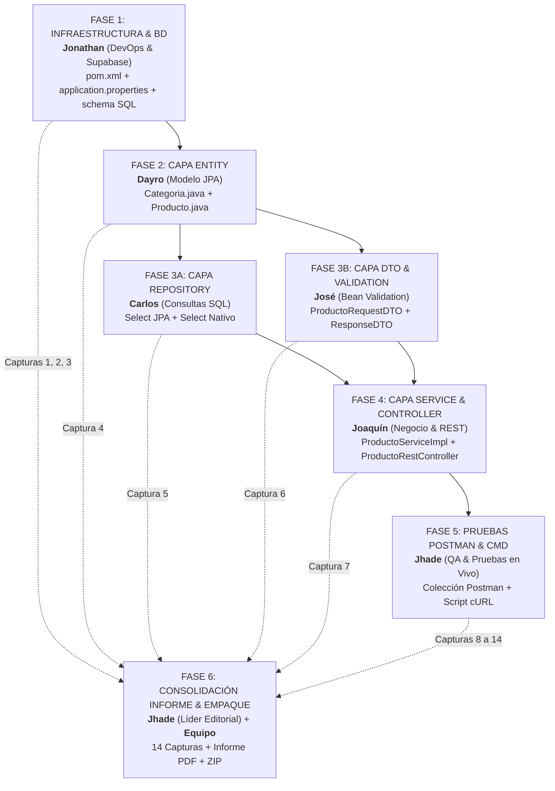

# PC3_INSTRUCCIONES.md — Guía Maestra de Implementación y Contrato Técnico
## OverText E-commerce (Spring Boot + Supabase PostgreSQL)

**Curso:** Marcos de Desarrollo Web (UTP 2026-2) — Sección 38189 — Grupo 01  
**Base de Datos en la Nube:** Supabase (PostgreSQL)  
**Arquitectura:** 100% Backend REST (Spring Boot Multicapas: Entity, DTO, Repository, Service, ServiceImpl, RestController)  
**Equipo (6 integrantes):** Jonathan · Dayro · Carlos · José · Joaquín · Jhade  
**Rama de integración:** `testing` (Constitución art. 9: *Un archivo, un escritor*)  

> **Propósito de este documento:**  
> Especificación técnica exhaustiva, matriz de responsabilidades individuales, contrato canónico de datos y orden cronológico de trabajo para la **Práctica Calificada 3 (PC3)**.  
> Sirve como la **guía maestra de implementación** para desarrolladores y agentes de IA autónomos, garantizando el cumplimiento de los 8 criterios de evaluación de `P3.md` con cero conflictos de integración en Git.

> [!IMPORTANT]
> **Alcance 100% Backend para la P3:**
> La evaluación de la P3 es **estrictamente de Backend (APIs REST y persistencia)**. Ningún integrante tiene asignado maquetar vistas HTML, CSS, JavaScript ni formularios en Thymeleaf. Todo el CRUD (`GET`, `POST`, `PUT`, `DELETE`), las validaciones y las consultas JPA/Nativas se operan y demuestran exclusivamente mediante **Postman y scripts de consola con cURL**. El frontend de la P2 queda completamente congelado.  

---

## 1. Objetivos del Entregable (Según `P3.md`)

1. **Reutilizar el desarrollo web de la P2** y completarlo con **Spring Boot Multicapas**:
   - `Entity`, `DTO`, `Controller` (REST + MVC), `Repository`, `Service` y `ServiceImpl`.
2. **Conexión a Base de Datos:** Conectar a **PostgreSQL** en la nube con **Supabase** (credenciales por variables de entorno).
3. **Operaciones CRUD:** Endpoints para `GET`, `POST`, `PUT`, `DELETE`.
4. **Ejecución y Pruebas de APIs:** Ejecutables en **Postman** y mediante scripts en terminal/CMD con **cURL**.
5. **Consultas en Repositorio:**
   - Un `SELECT` con **JPA** (método derivado).
   - Un `SELECT` **Nativo** (`@Query(..., nativeQuery = true)`).
6. **DTO con Validaciones Bean Validation:**
   - `@Size`, `@Email`, `@NotNull`, `@Positive`, `@NotBlank`.
7. **Controlador con Validaciones:**
   - Validación en método `POST` (`@Valid`).
   - Validación en método `GET` (`@Positive` en parámetro `@PathVariable`).
8. **Documentación Formal UTP & 14 Capturas Obligatorias:**
   - Informe formal con estructura UTP (Capítulos 2, 3, Pruebas y Bibliografía APA).
   - Capturas en Postman, CMD/cURL, Supabase y Código en IDE.

---

## 2. Protocolo Anti-Conflictos Git (*Un archivo, un escritor*)

Para garantizar **cero conflictos de merge** al trabajar 6 personas sobre el mismo repositorio, se establecen las siguientes reglas de trabajo:

1. **Aislamiento Estricto de Archivos:** Cada integrante tiene propiedad **exclusiva** sobre los archivos de su capa. Ningún integrante edita archivos asignados a otro compañero.
2. **Ramas Independientes:** Cada integrante trabaja en su rama (`feature/p3-<nombre>-<capa>`) y solo se integrará a `testing` una vez validada la fase previa.
3. **Ruta Centralizada de Capturas:** Todas las capturas se guardan en `informes/capturas/pc3/` con la nomenclatura oficial `01-supabase-dashboard.png`, `02-...`, etc.
4. **Secciones de Documentación Modulares:** Para no generar conflictos en el documento principal, cada integrante redacta su sección en su propia bitácora o en archivos modulares en `informes/secciones-p3/` y marca sus avances en **[`docs/pc3-tablero-control.md`](Desktop/Overtext-Web/docs/pc3-tablero-control.md)**. Jhade, como editora única del informe (art. 10 y decisión 18), consolida el archivo maestro `informes/informe-p3.md`.

---

## 3. Contrato Canónico de Datos (Para Evitar Alucinaciones de la IA)

Cualquier agente de IA o desarrollador que genere código en `entity/`, `dto/`, `repository/`, `service/` o `controller/api/` **debe adherirse de manera estricta a estos nombres de atributos y tipos de datos Java**:

### A. Modelo de `Categoria`
- `Long id` (PK, `@Id`, `@GeneratedValue(strategy = GenerationType.IDENTITY)`)
- `String nombre` (Nombre de la categoría)
- `String slug` (Identificador único URL)
- `String descripcion` (Descripción opcional)
- `Boolean activo` (Estado, default `true`)

### B. Modelo de `Producto`
| Nombre de Variable Java | Tipo de Dato Java | Columna en PostgreSQL | Anotaciones Bean Validation en `ProductoRequestDTO` |
|---|:---:|:---:|---|
| `id` | `Long` | `id` (BIGSERIAL) | *(Solo lectura en salida, no se valida en creación)* |
| `codigo` | `String` | `codigo` (VARCHAR) | `@NotBlank(message = "El código es obligatorio")` |
| `nombre` | `String` | `nombre` (VARCHAR) | `@NotBlank(message = "El nombre es obligatorio")`<br>`@Size(min = 3, max = 100, message = "Debe tener entre 3 y 100 caracteres")` |
| `slogan` | `String` | `slogan` (VARCHAR) | *(Opcional)* |
| `descripcion` | `String` | `descripcion` (TEXT) | *(Opcional)* |
| `precio` | `Double` | `precio` (DECIMAL) | `@NotNull(message = "El precio es obligatorio")`<br>`@Positive(message = "El precio debe ser mayor a 0")` |
| `precioPack` | `Double` | `precio_pack` (DECIMAL) | `@PositiveOrZero(message = "El precio de pack no puede ser negativo")` |
| `stock` | `Integer` | `stock` (INT) | `@NotNull(message = "El stock es obligatorio")`<br>`@PositiveOrZero(message = "El stock no puede ser negativo")` |
| `imagenPrincipal` | `String` | `imagen_principal` (VARCHAR) | *(Opcional)* |
| `colorNombre` | `String` | `color_nombre` (VARCHAR) | `@NotBlank(message = "El nombre del color es obligatorio")` |
| `colorHex` | `String` | `color_hex` (VARCHAR) | `@NotBlank(message = "El código hexadecimal es obligatorio")` |
| `correoProveedor` | `String` | `correo_proveedor` (VARCHAR) | `@NotBlank(message = "El correo es obligatorio")`<br>`@Email(message = "Debe ser un correo electrónico válido")` |
| `activo` | `Boolean` | `activo` (BOOLEAN) | *(Por defecto true)* |
| `categoriaId` | `Long` | `categoria_id` (BIGINT) | `@NotNull(message = "La categoría es obligatoria")`<br>`@Positive(message = "El ID de categoría debe ser válido")` |

> [!CAUTION]
> **Prohibido modificar los tipos canónicos:** No uses `BigDecimal` ni `float` para precios; usa unificado `Double`. No uses `int` primitivo; usa `Integer`. No uses `long` primitivo; usa `Long`. Esto garantiza que los agentes de Dayro, Carlos, José y Joaquín interoperen sin inconsistencias de tipos.

---

## 4. Flujo Cronológico de Avance por Fases (Sin Bloqueos ni Conflictos)



---

## 5. Detalle de Responsabilidades Paso a Paso (Código, Documentación y Capturas)

---

### FASE 1: Limpieza de Frontend, Conversión a Backend REST Puro e Infraestructura Supabase
* **Responsable:** **Jonathan** (Scrum Master & DevOps)  
* **Rama Git:** `feature/p3-jonathan-supabase-backend`  
* **Prerrequisito:** Ninguno (Punto de partida).  
* **Archivos a su cargo:**
  - `overtext/pom.xml` (Retirar dependencia `spring-boot-starter-thymeleaf`, añadir `postgresql`, `spring-boot-starter-data-jpa`, `spring-boot-starter-validation`).
  - Desacoplar los controladores HTML de la P2 (`CatalogoController`, `HomeController`, `CheckoutController`, `ContactoController`, `IntranetController`, `LoginController`, `NosotrosController`, `ProductoController`, `PromocionesController`), dejando la arquitectura lista para los `@RestController` de la P3.
  - Limpieza de `src/main/resources/templates/` y recursos estáticos no requeridos en la API para garantizar un entregable 100% Backend limpio.
  - `overtext/src/main/resources/application.properties` (Datasource Supabase PostgreSQL y variables de entorno).
  - `overtext/src/main/resources/schema-supabase.sql` (Script DDL y datos iniciales para Supabase).
* **Entregables de Código:**
  1. Conversión completa a **Backend REST Puro**: La aplicación Spring Boot arranca sin dependencias ni controladores frontend, sirviendo exclusivamente respuestas JSON.
  2. Conexión establecida y verificada contra Supabase mediante JDBC PostgreSQL.
  3. Tablas `categoria` y `producto` creadas en Supabase con sus 7 registros sembrados.
  4. Compilación y test limpios con `./mvnw clean compile` y `./mvnw test`.
* **Entregable de Documentación:**
  - Redactar: *Capítulo 3.1: Conexión a Base de Datos en la Nube con Supabase y Conversión a Backend REST*.
* **Capturas Obligatorias a su cargo:**
  - 📸 **Captura 1:** `informes/capturas/pc3/01-supabase-dashboard.png` (Dashboard web de Supabase con el proyecto activo).
  - 📸 **Captura 2:** `informes/capturas/pc3/02-supabase-tablas.png` (Table Editor de Supabase con los 7 productos y categorías).
  - 📸 **Captura 3:** `informes/capturas/pc3/03-cmd-arranque-hikari.png` (Consola CMD / Terminal mostrando arranque limpio de Spring Boot REST y conexión HikariCP a Supabase en puerto 8080).
* **Hito de Cierre Fase 1:** PR a `testing` aprobado. Todo el equipo hace `git pull origin testing`. Backend 100% puro operativo.

---

### FASE 2: Capa Entity (Modelo de Dominio y Persistencia)
* **Responsable:** **Dayro**  
* **Rama Git:** `feature/p3-dayro-entity`  
* **Prerrequisito:** Fase 1 mergeada a `testing`.  
* **Archivos exclusivos a su cargo:**
  - `overtext/src/main/java/pe/edu/utp/overtext/entity/Categoria.java`
  - `overtext/src/main/java/pe/edu/utp/overtext/entity/Producto.java`
* **Entregables de Código:**
  1. Clase `Categoria` con anotaciones `@Entity`, `@Table`, `@Id`, `@GeneratedValue(strategy = GenerationType.IDENTITY)` y relación `@OneToMany`.
  2. Clase `Producto` con `@Entity`, `@Table`, relación `@ManyToOne` hacia `Categoria`, campos de precio, stock, código, imágenes y `correoProveedor`.
* **Entregable de Documentación:**
  - Redactar: *Capítulo 3.2: Modelo de Dominio y Mapeo Objeto-Relacional (JPA)* con el diccionario de campos de ambas entidades.
* **Capturas Obligatorias a su cargo:**
  - 📸 **Captura 4:** `informes/capturas/pc3/04-entidades-jpa.png` (Código en IDE mostrando las anotaciones `@Entity`, `@Id` y `@ManyToOne`).
* **Hito de Cierre Fase 2:** PR a `testing` aprobado. Todo el equipo hace `git pull origin testing`. Desbloquea a Carlos y José.

---

### FASE 3 (En Paralelo sin Conflictos): Repositorios y DTOs

#### FASE 3A: Capa Repository (Consultas JPA y Consulta SQL Nativa)
* **Responsable:** **Carlos**  
* **Rama Git:** `feature/p3-carlos-repository`  
* **Prerrequisito:** Fase 2 en `testing`.  
* **Archivos exclusivos a su cargo:**
  - `overtext/src/main/java/pe/edu/utp/overtext/repository/CategoriaRepository.java`
  - `overtext/src/main/java/pe/edu/utp/overtext/repository/ProductoRepository.java`
* **Entregables de Código:**
  1. `CategoriaRepository` extendiendo `JpaRepository<Categoria, Long>`.
  2. `ProductoRepository` extendiendo `JpaRepository<Producto, Long>`.
  3. **Select JPA:** `List<Producto> findByActivoTrue();`.
  4. **Select Nativo (Requisito P3):**
     ```java
     @Query(value = "SELECT * FROM producto WHERE stock > 0 AND activo = true ORDER BY precio ASC", nativeQuery = true)
     List<Producto> listarProductosDisponiblesNativo();
     ```
* **Entregable de Documentación:**
  - Redactar: *Capítulo 3.3: Capa de Persistencia y Consultas: JPA vs SQL Nativo*.
* **Capturas Obligatorias a su cargo:**
  - 📸 **Captura 5:** `informes/capturas/pc3/05-cmd-query-nativa-logs.png` (Terminal/CMD con Hibernate mostrando la ejecución del SQL nativo en consola).

---

#### FASE 3B: Capa DTO y Reglas de Bean Validation
* **Responsable:** **José**  
* **Rama Git:** `feature/p3-jose-dto`  
* **Prerrequisito:** Fase 2 en `testing`.  
* **Archivos exclusivos a su cargo:**
  - `overtext/src/main/java/pe/edu/utp/overtext/dto/ProductoRequestDTO.java`
  - `overtext/src/main/java/pe/edu/utp/overtext/dto/ProductoResponseDTO.java`
  - `overtext/src/main/java/pe/edu/utp/overtext/dto/CategoriaDTO.java`
* **Entregables de Código:**
  1. `ProductoRequestDTO` con las 5 anotaciones estrictas de `P3.md`:
     - `@NotBlank` (código y nombre)
     - `@Size(min = 3, max = 100)` (nombre)
     - `@NotNull` (precio, stock, categoría)
     - `@Positive` (precio mayor a 0)
     - `@Email` (correo del proveedor)
  2. `ProductoResponseDTO` para transferir respuestas limpias a Postman/Frontend.
* **Entregable de Documentación:**
  - Redactar: *Capítulo 3.4: Capa DTO y Validación con Bean Validation* con tabla de validaciones campo por campo.
* **Capturas Obligatorias a su cargo:**
  - 📸 **Captura 6:** `informes/capturas/pc3/06-dto-validaciones-codigo.png` (Código en IDE del DTO con las 5 anotaciones visibles).

* **Hito de Cierre Fase 3:** Carlos y José hacen PR de sus respectivas ramas a `testing`. Como tocan carpetas diferentes (`repository/` y `dto/`), se mergean sin ningún conflicto. Desbloquea a Joaquín.

---

### FASE 4: Capa Service y Controladores REST con Validaciones
* **Responsable:** **Joaquín**  
* **Rama Git:** `feature/p3-joaquin-service-api`  
* **Prerrequisito:** Fase 3A y 3B en `testing`.  
* **Archivos exclusivos a su cargo:**
  - `overtext/src/main/java/pe/edu/utp/overtext/service/ProductoService.java`
  - `overtext/src/main/java/pe/edu/utp/overtext/service/impl/ProductoServiceImpl.java`
  - `overtext/src/main/java/pe/edu/utp/overtext/controller/api/ProductoRestController.java`
  - `overtext/src/main/java/pe/edu/utp/overtext/controller/advice/GlobalExceptionHandler.java`
* **Entregables de Código:**
  1. `ProductoServiceImpl` anotado con `@Service` y `@Transactional`, conectando con los repositorios de Supabase y convirtiendo Entity/DTO.
  2. `ProductoRestController` anotado con `@RestController`, `@RequestMapping("/api/productos")`, `@Validated`:
     - `GET /api/productos` (Select JPA).
     - `GET /api/productos/nativos` (Select Nativo).
     - `GET /api/productos/{id}` con validación `@PathVariable @Positive Long id`.
     - `POST /api/productos` con validación `@Valid @RequestBody ProductoRequestDTO dto`.
     - `PUT /api/productos/{id}` con validación `@PathVariable @Positive` y `@Valid`.
     - `DELETE /api/productos/{id}` con validación `@PathVariable @Positive`.
  3. `GlobalExceptionHandler` con `@RestControllerAdvice` para capturar errores de validación y devolverlos en HTTP 400 Bad Request formateados en JSON.
* **Entregable de Documentación:**
  - Redactar: *Capítulo 3.5: Lógica de Servicios y Endpoints de la API REST*.
* **Capturas Obligatorias a su cargo:**
  - 📸 **Captura 7:** `informes/capturas/pc3/07-postman-endpoints-list.png` (Estructura de la colección en Postman con las peticiones configuradas).
* **Hito de Cierre Fase 4:** PR a `testing` aprobado. Todo el equipo hace `git pull origin testing`. Desbloquea a Jhade.

---

### FASE 5: Pruebas de APIs en Postman y Terminal/CMD con cURL
* **Responsable:** **Jhade** (con soporte de ejecución de Joaquín)  
* **Rama Git:** `feature/p3-jhade-qa-documentacion`  
* **Prerrequisito:** Backend levantado y corriendo en `http://localhost:8080`.  
* **Archivos exclusivos a su cargo:**
  - `docs/pruebas/OverText_PC3_Postman_Collection.json` (Colección exportada de Postman).
  - `docs/pruebas/pruebas_curl_pc3.sh` (Script ejecutable de cURL).
* **Entregables Técnicos & QA:**
  1. Ejecución de las 7 peticiones en Postman verificando respuestas y códigos de estado.
  2. Ejecución del script `bash docs/pruebas/pruebas_curl_pc3.sh` en Terminal / CMD.
* **Capturas Obligatorias a su cargo:**
  - 📸 **Captura 8:** `informes/capturas/pc3/08-postman-get-jpa.png` (`GET /api/productos` retornando 200 OK y JSON de productos).
  - 📸 **Captura 9:** `informes/capturas/pc3/09-postman-get-nativo.png` (`GET /api/productos/nativos` retornando 200 OK con productos en stock).
  - 📸 **Captura 10:** `informes/capturas/pc3/10-postman-get-invalido.png` (`GET /api/productos/-5` retornando **HTTP 400 Bad Request** demostrando validación en GET).
  - 📸 **Captura 11:** `informes/capturas/pc3/11-postman-post-valido.png` (`POST /api/productos` retornando **HTTP 201 Created** y producto persistido en Supabase).
  - 📸 **Captura 12:** `informes/capturas/pc3/12-postman-post-errores.png` (`POST` con datos erróneos retornando **HTTP 400** con los mensajes de `@Size`, `@Email`, `@NotNull`, `@Positive`, `@NotBlank`).
  - 📸 **Captura 13:** `informes/capturas/pc3/13-postman-put-delete.png` (`PUT` actualización y `DELETE` eliminación).
  - 📸 **Captura 14:** `informes/capturas/pc3/14-cmd-curl-ejecucion.png` (Consola CMD / Terminal ejecutando la suite cURL con todos los verbos HTTP).

---

### FASE 6: Consolidación del Informe Oficial UTP y Empaquetado
* **Responsables:** **Jhade** (Editora Única) y **Jonathan** (Scrum Master / Verificación cruzada)  
* **Prerrequisito:** Todas las capturas (1 a 14) archivadas en `informes/capturas/pc3/` y aportes de texto listos.  
* **Archivos exclusivos a su cargo:**
  - `informes/informe-p3.md` (Documento maestro consolidado).
  - Exportación a `PC3_GRUPO_01.pdf`.
  - Archivo comprimido de entrega `PC3_GRUPO_01.rar` o `.zip`.
* **Actividades de Cierre:**
  1. Jhade compila el documento integrando la Carátula UTP, Capítulos 2 y 3, la galería comentada de las 14 capturas y la bibliografía en formato APA.
  2. Exportación a PDF limpio y sin errores visuales.
  3. Ejecutar `mvn clean` para borrar la carpeta `target/` antes de empaquetar.
  4. Jonathan realiza la verificación cruzada en otra máquina confirmando que el archivo abre sin contraseña ni corrupción.

---

## 6. Matriz Resumen de Trazabilidad Frente a la Rúbrica P3

| Criterio Evaluado en `P3.md` | Responsable Técnico | Responsable Documentación | Evidencia Entregable |
|---|:---:|:---:|---|
| **Reutilización P2** | Todo el equipo | Jhade | Proyecto Spring Boot de P2 reutilizado como base del backend multicapas. |
| **Arquitectura Multicapas** (Entity, DTO, Controller, Repository, Service, ServiceImpl) | Dayro, José, Joaquín, Carlos | Jhade / Todos | Paquetes en `src/main/java/pe/edu/utp/overtext/` + Capturas 4, 6, 7. |
| **Conexión a Supabase (PostgreSQL)** | Jonathan | Jonathan | `application.properties`, driver postgresql + Capturas 1, 2, 3. |
| **CRUD Completo (GET, POST, PUT, DELETE)** | Joaquín | Joaquín / Jhade | Endpoints en `ProductoRestController` + Capturas 8, 11, 13. |
| **Ejecución en Postman y cURL/CMD** | Jhade | Jhade | Colección Postman, `pruebas_curl_pc3.sh` + Capturas 8 a 14. |
| **Select JPA y Select Nativo** | Carlos | Carlos | Métodos en `ProductoRepository` + Capturas 5, 8, 9. |
| **DTO con @Size, @Email, @NotNull, @Positive, @NotBlank** | José | José | Anotaciones en `ProductoRequestDTO` + Capturas 6 y 12. |
| **Controlador con Validaciones en POST y GET** | Joaquín | Joaquín / Jhade | `@Valid` en POST y `@Positive` en GET + Capturas 10 y 12. |

---

## 7. Checklist de Verificación Final Antes de Entregar

- [ ] Las 14 capturas existen en `informes/capturas/pc3/` con nombres normalizados.
- [ ] La base de datos en Supabase tiene los registros activos y responde por JDBC.
- [ ] `./mvnw clean test` compila sin ningún error ni advertencia.
- [ ] El script `bash docs/pruebas/pruebas_curl_pc3.sh` corre al 100% en consola.
- [ ] Verificado enfoque 100% Backend: APIs REST operativas en Postman y cURL sin requerir maquetado frontend.
- [ ] El informe `PC3_GRUPO_01.pdf` incluye carátula UTP, los 3 capítulos, evidencias y bibliografía APA.
- [ ] El paquete comprimido no contiene la carpeta `target/` ni archivos temporales.
