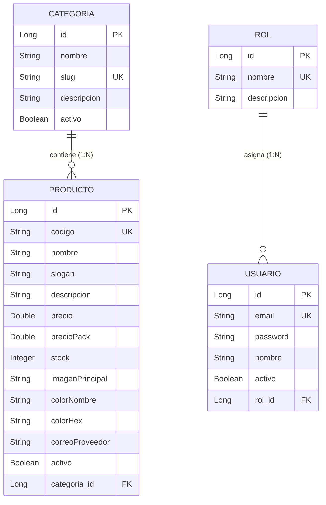

# Capítulo 3.2: Modelo de Dominio y Mapeo Objeto-Relacional (JPA)

**Responsable:** Dayro (Backend Developer - Capa Entity)  
**Proyecto:** OverText E-commerce (Streetwear Peruano)  
**Entregable:** Práctica Calificada 3 (PC3) / ATF3  

---

## 1. Introducción al Mapeo Objeto-Relacional (JPA / Hibernate)

En el marco de la arquitectura multicapas de Spring Boot para la API REST de OverText, la **Capa Entity** define el modelo de dominio y la persistencia de datos. Utilizando la especificación Jakarta Persistence API (JPA) implementada a través de Hibernate, las clases Java se mapean directamente con las tablas relacionales alojadas en PostgreSQL (Supabase).

Este enfoque garantiza:
- **Abstracción del motor de base de datos:** El acceso y manipulación de datos se gestiona mediante objetos Java fuertemente tipados.
- **Integridad referencial:** Las relaciones de clave foránea (`categoria_id` y `rol_id`) se modelan mediante asociaciones `@ManyToOne` y `@OneToMany`.
- **Estandarización de tipos:** Se respeta el contrato canónico del proyecto evitando discrepancias de tipo entre el modelo relacional y la capa de transferencia DTO.

---

## 2. Diccionario de Entidades y Campos

### A. Entidad `Categoria` (`pe.edu.utp.overtext.entity.Categoria`)
Mapea la tabla `categoria`. Representa las agrupaciones del catálogo de prendas streetwear (ej. "Shorts Urbanos").

| Atributo Java | Tipo de Dato | Columna PostgreSQL | Modificadores / Restricciones | Descripción |
|---|:---:|:---:|---|---|
| `id` | `Long` | `id` | `BIGSERIAL`, `@Id`, `@GeneratedValue(IDENTITY)` | Clave primaria autoincremental |
| `nombre` | `String` | `nombre` | `VARCHAR(60)`, `nullable = false` | Nombre legible de la categoría |
| `slug` | `String` | `slug` | `VARCHAR(60)`, `nullable = false`, `unique = true` | Identificador amigable para URLs |
| `descripcion` | `String` | `descripcion` | `VARCHAR(255)`, `nullable = true` | Descripción general de la línea |
| `activo` | `Boolean` | `activo` | `BOOLEAN`, `nullable = false`, default `true` | Indicador de disponibilidad lógica |
| `productos` | `List<Producto>` | — | `@OneToMany(mappedBy = "categoria")`, `LAZY` | Colección de productos asociados |

---

### B. Entidad `Producto` (`pe.edu.utp.overtext.entity.Producto`)
Mapea la tabla `producto`. Constituye el recurso central del catálogo streetwear para las operaciones CRUD y consultas del sistema.

| Atributo Java | Tipo de Dato | Columna PostgreSQL | Modificadores / Restricciones | Descripción |
|---|:---:|:---:|---|---|
| `id` | `Long` | `id` | `BIGSERIAL`, `@Id`, `@GeneratedValue(IDENTITY)` | Clave primaria del producto |
| `codigo` | `String` | `codigo` | `VARCHAR(40)`, `nullable = false`, `unique = true` | Código SKU identificador único |
| `nombre` | `String` | `nombre` | `VARCHAR(100)`, `nullable = false` | Nombre comercial del artículo |
| `slogan` | `String` | `slogan` | `VARCHAR(150)`, `nullable = true` | Frase promocional corta |
| `descripcion` | `String` | `descripcion` | `TEXT`, `nullable = true` | Ficha técnica y detalle de confección |
| `precio` | `Double` | `precio` | `DECIMAL(10,2)`, `nullable = false` | Precio regular en Soles (PEN) |
| `precioPack` | `Double` | `precio_pack` | `DECIMAL(10,2)`, `nullable = true` | Precio especial por compra en combo |
| `stock` | `Integer` | `stock` | `INT`, `nullable = false` | Unidades físicas disponibles |
| `imagenPrincipal` | `String` | `imagen_principal` | `VARCHAR(255)`, `nullable = true` | Ruta relativa o URL del activo visual |
| `colorNombre` | `String` | `color_nombre` | `VARCHAR(40)`, `nullable = false` | Nombre del color (ej. "Oliva Militar") |
| `colorHex` | `String` | `color_hex` | `VARCHAR(10)`, `nullable = false` | Código hexadecimal para UI |
| `correoProveedor` | `String` | `correo_proveedor` | `VARCHAR(100)`, `nullable = false` | Email de contacto del fabricante |
| `activo` | `Boolean` | `activo` | `BOOLEAN`, `nullable = false`, default `true` | Estado activo/inactivo para baja lógica |
| `categoria` | `Categoria` | `categoria_id` | `@ManyToOne(fetch = EAGER)`, `@JoinColumn` | Llave foránea hacia tabla `categoria` |

---

### C. Entidad `Rol` (`pe.edu.utp.overtext.entity.Rol`)
Mapea la tabla `rol`. Define los perfiles de acceso y autorización del sistema de backend (ej. "ADMIN", "CLIENTE").

| Atributo Java | Tipo de Dato | Columna PostgreSQL | Modificadores / Restricciones | Descripción |
|---|:---:|:---:|---|---|
| `id` | `Long` | `id` | `BIGSERIAL`, `@Id`, `@GeneratedValue(IDENTITY)` | Clave primaria del rol |
| `nombre` | `String` | `nombre` | `VARCHAR(40)`, `nullable = false`, `unique = true` | Nombre del rol (ej. "ADMIN") |
| `descripcion` | `String` | `descripcion` | `VARCHAR(150)`, `nullable = true` | Alcance y permisos del rol |
| `usuarios` | `List<Usuario>` | — | `@OneToMany(mappedBy = "rol")`, `LAZY` | Usuarios que ostentan este rol |

---

### D. Entidad `Usuario` (`pe.edu.utp.overtext.entity.Usuario`)
Mapea la tabla `usuario`. Representa a los usuarios del sistema, sus credenciales y su asignación de rol.

| Atributo Java | Tipo de Dato | Columna PostgreSQL | Modificadores / Restricciones | Descripción |
|---|:---:|:---:|---|---|
| `id` | `Long` | `id` | `BIGSERIAL`, `@Id`, `@GeneratedValue(IDENTITY)` | Clave primaria del usuario |
| `email` | `String` | `email` | `VARCHAR(100)`, `nullable = false`, `unique = true` | Correo electrónico / login |
| `password` | `String` | `password` | `VARCHAR(255)`, `nullable = false` | Hash seguro de la contraseña |
| `nombre` | `String` | `nombre` | `VARCHAR(100)`, `nullable = false` | Nombre completo del usuario |
| `activo` | `Boolean` | `activo` | `BOOLEAN`, `nullable = false`, default `true` | Estado del usuario en el sistema |
| `rol` | `Rol` | `rol_id` | `@ManyToOne(fetch = EAGER)`, `@JoinColumn` | Llave foránea hacia tabla `rol` |

---

## 3. Diagrama de Relaciones de Entidades

---

## 4. Evidencias de Mapeo en el IDE (Captura 4)

A continuación se registran las evidencias fotográficas del código fuente en el entorno de desarrollo, demostrando las anotaciones `@Entity`, `@Table`, `@Id`, `@GeneratedValue`, `@Column`, `@ManyToOne` y `@OneToMany`:

* **Captura 4.1:** [`informes/capturas/pc3/04-1-entidades-jpa.png`](file:///c:/WEB/Overtext-Web/informes/capturas/pc3/04-1-entidades-jpa.png)  
  *Descripción:* Entidad **`Categoria`** — Mapeo a la tabla `categoria`, clave primaria autoincremental y relación bidireccional `@OneToMany` hacia `Producto`.

* **Captura 4.2:** [`informes/capturas/pc3/04-2-entidades-jpa.png`](file:///c:/WEB/Overtext-Web/informes/capturas/pc3/04-2-entidades-jpa.png)  
  *Descripción:* Entidad **`Producto`** — Mapeo a la tabla `producto`, definición de tipos canónicos (`Double`, `Integer`), columnas y relación foránea `@ManyToOne` hacia `Categoria`.

* **Captura 4.3:** [`informes/capturas/pc3/04-3-entidades-jpa.png`](file:///c:/WEB/Overtext-Web/informes/capturas/pc3/04-3-entidades-jpa.png)  
  *Descripción:* Entidad **`Rol`** — Mapeo a la tabla `rol`, atributos `nombre` y `descripcion`, y relación `@OneToMany` hacia `Usuario`.

* **Captura 4.4:** [`informes/capturas/pc3/04-4-entidades-jpa.png`](file:///c:/WEB/Overtext-Web/informes/capturas/pc3/04-4-entidades-jpa.png)  
  *Descripción:* Entidad **`Usuario`** — Mapeo a la tabla `usuario`, campos de autenticación (`email`, `password`, `activo`) y relación foránea `@ManyToOne` hacia `Rol` con `@JoinColumn(name = "rol_id")`.

